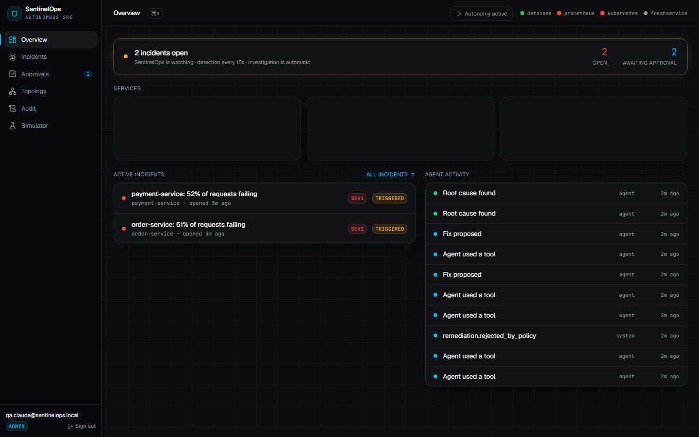
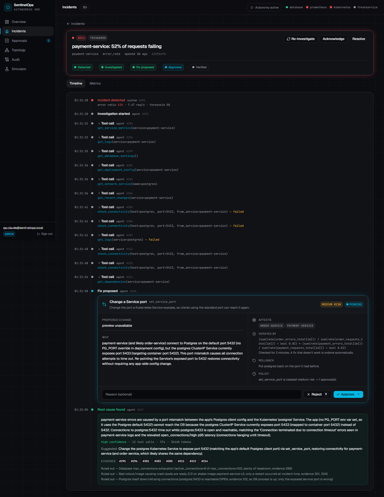
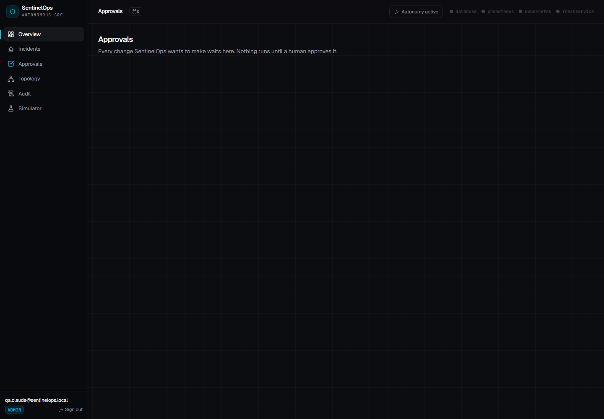

# SentinelOps AI

**Autonomous incident response that is allowed to act on production — safely.**

SentinelOps watches a Kubernetes system, detects incidents, investigates them with an AI
agent that must cite evidence, and proposes fixes from a fixed catalog of safe actions.
A human approves, the fix runs, recovery is verified, failed fixes roll back automatically,
and every step lands in a tamper-evident, hash-chained event log.

> Built for The Great Agent Hackathon (Freshworks, Bengaluru, 25–26 Sep 2026),
> Track 3 — AI-native Enterprise.
> **[docs/how-it-runs.md](docs/how-it-runs.md)** explains the stack and what happens when each
> part fails. **[docs/glossary.md](docs/glossary.md)** defines every term used here.
> [docs/implementation-plan.md](docs/implementation-plan.md) has the full plan.



## The problem

When production breaks at 2 a.m., most AI tools stop at *diagnosis*: they tell an engineer
what is probably wrong, and a human still has to find the fix, apply it by hand, and check it
worked. Tools that go further and *act* tend to be trusted with far too much — an AI that can
run arbitrary commands against production is a liability, not a colleague.

## What SentinelOps does differently: governed autonomy

The AI is allowed to act, but only inside fences that do not depend on the AI behaving well.

| Fence | How it is enforced |
|---|---|
| **A fixed menu of actions** | The agent picks from a catalog (`restart_service`, `scale_service`, `set_service_port`, `set_database_max_connections`) with typed, validated parameters. It cannot write commands. |
| **An allow-list** | Only named deployments and services in one namespace, and only allowed values (e.g. port 5432). Anything else is refused server-side. |
| **Plain-code policy** | A table-driven function, not the AI, decides risk and how many approvals a fix needs. |
| **Enforced human approval** | Only the `approver` role can approve; the approve is an atomic database transition, so a double-click cannot run a fix twice. There is no path to execution without an approved proposal. |
| **Verify, then roll back** | After executing, SentinelOps watches the error rate. No recovery → the change is rolled back automatically. |
| **Kill switch** | One switch pauses all execution. |
| **Least-privilege identity** | The backend acts through a dedicated Kubernetes ServiceAccount that can patch the allowed objects and cannot delete anything or read `kube-system`. |
| **Tamper-evident record** | Every step is an append-only event whose hash includes the previous event's hash. The database rejects edits and deletes on the table. |

## The loop

```
break → detect → investigate → propose → approve → execute → verify → (rollback) → audit
```

1. **Detect.** Every 15 s the detector asks Prometheus for each service's error ratio. Above
   5 % on two consecutive checks opens an incident (one per problem, deduplicated).
2. **Investigate.** Claude Sonnet 5 investigates with read-only tools (metrics, logs, pods,
   deployment config, network service, recent changes, dependencies, database settings, and a
   live TCP connectivity probe from inside a pod). Its conclusion must cite the tool results
   it relied on; a claim without evidence is rejected.
3. **Propose.** The agent may propose one action from the catalog. The server validates it
   against the allow-list and the policy, and shows a live before/after diff from the cluster.
4. **Approve.** The approval card reads like a pull request: what changes, why, the
   evidence, who is affected, how success is checked, and how to undo it.
5. **Execute → verify → roll back.** The executor re-checks the kill switch and the proposal
   before acting, records the "before" state, applies the change, then verifies recovery or
   rolls back. One outage that raised several incidents produces one proposal, and a
   successful fix closes all of them.




## Architecture

```
 ┌──────────────── Laptop ─────────────────────────────────────────────┐
 │  Kubernetes (Docker Desktop)                                         │
 │   order-service ─┐                                                   │
 │   payment-service┼──► postgres   (the MONITORED system)              │
 │   prometheus ◄───┘  scrapes /metrics every 5s                        │
 │        ▲                    ▲                                        │
 │        │ PromQL (pull)      │ k8s API (read + limited patch)          │
 │  ┌─────┴────────────────────┴────────┐                               │
 │  │ SentinelOps backend (FastAPI)      │── Claude API (agent)         │
 │  │ detector · agent · policy ·        │                              │
 │  │ executor · verifier                │                              │
 │  └─────┬──────────────────────────────┘                              │
 │        │                     ┌──────────────────────┐                │
 │        │                     │ Frontend (React/Vite)│                │
 │        │                     └──────────────────────┘                │
 └────────┼────────────────────────────────────────────────────────────┘
          │ SQL + Realtime + Auth
   ┌──────▼──────────────┐
   │ Supabase             │  SentinelOps' OWN database — separate from the
   └──────────────────────┘  monitored Postgres, so it stays up while that is down
```

| Layer | Stack |
|---|---|
| Frontend | React 19, TypeScript, Vite, Tailwind, shadcn/ui, Recharts, TanStack Query |
| Backend | Python 3.12+, FastAPI, Pydantic v2, uv |
| Database, auth, live updates | Supabase (Postgres, Auth, Realtime) |
| Telemetry | Prometheus (PromQL over HTTP) |
| Cluster access | Kubernetes Python client, least-privilege ServiceAccount |
| AI | Claude Sonnet 5 via tool use (Anthropic Python SDK) |

## Repository layout

| Path | What |
|---|---|
| `backend/app/core/` | Config, database, auth, event bus + hash chain, health |
| `backend/app/features/` | One folder per feature: `incidents` (detector), `investigation` (agent + tools), `remediation` (catalog, policy, executor), `simulator`, `topology` |
| `backend/tests/` | Unit tests (safety rules, detection, agent, executor) and database tests |
| `frontend/src/` | App shell, feature pages, shared UI |
| `services/` | The *monitored* demo system: order-service, payment-service, Postgres, Prometheus |
| `supabase/migrations/` | SentinelOps' own database schema |
| `docs/` | Plans, how it runs, test checklist, screenshots |

## Running locally

Prerequisites: Docker Desktop with Kubernetes enabled, Node 20+, [uv](https://docs.astral.sh/uv/).

```bash
cp .env.example .env            # then fill in the values

# 1. Demo system
docker build -t order-service:v2 services/order-service
docker build -t payment-service:v2 services/payment-service
kubectl apply -f services/k8s/

# 2. SentinelOps' least-privilege cluster identity + database schema
cd backend
uv run python scripts/make_agent_kubeconfig.py
uv run python scripts/migrate.py

# 3. Backend (http://localhost:8000/api/health)
uv run python run.py            # not plain uvicorn: psycopg needs a SelectorEventLoop on Windows

# 4. Frontend (http://localhost:5173)
cd ../frontend && npm install && npm run dev
```

Then sign in, open **Simulator**, and press **Break it** on *Database port mismatch*. An
incident appears within about 35 s, and the investigation, proposal and approval card follow.

**Tests:** `cd backend && uv run pytest -q` (unit), `uv run pytest -q -m db` (database guarantees).

## What was built when

Judging weighs work done during the hackathon, so this is tracked honestly. The git history
and the `v0-pre-event` tag mark the boundary.

| Built before the event (up to tag `v0-pre-event`) | Built at the event |
|---|---|
| Demo system baseline, least-privilege cluster identity, Supabase schema, auth | _Freshservice integration — in progress_ |
| Event bus with hash chain; detector; live incident list; failure simulator | _Audit page and chain verification — in progress_ |
| Investigation agent with evidence-backed findings | |
| Safety core: action catalog, policy, enforced approval, executor, verification, rollback, kill switch | |
| Dark "command centre" UI: overview, incidents, incident detail, approvals, simulator, ⌘K palette | |
| Observability views: global time range, per-service charts (error rate, p95) with incident markers, outcome tiles (time to root cause / resolve), filterable incidents table with root cause, service side panel (metrics, DB connection pool, logs) | |
| Hardening from live runs: parallel in-pod probes no longer corrupt the shared Kubernetes client; one outage → one fix (proposals merged by target, never two changes to one target at once); clean timestamped logs for the agent | |

The monitored demo services in `services/` were first written for an earlier prototype
and adapted here; they are the system being watched, not the product.
